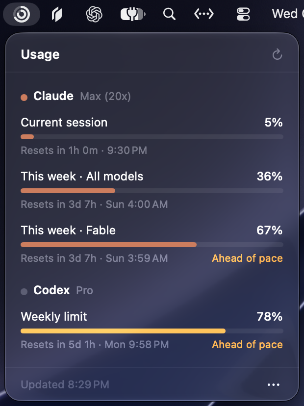

# TokenUsageMonitor

A tiny macOS menu bar app that shows your **Claude** and **Codex** plan limits: the same numbers you see on claude.ai → Settings → Usage and ChatGPT → Settings → Usage.

<p align="center"></p>

- **Menu bar only.** No Dock icon, no windows.
- **One glance.** The icon is two concentric rings: outer = Claude, inner = Codex. Each ring fills to that provider's most-used limit.
- **Click for details.** Every limit window shows its used %, a progress bar, the reset time, and an *Ahead of pace* hint when you're burning through it faster than time is passing.

## Requirements

- macOS 13 Ventura or later
- Xcode Command Line Tools (`xcode-select --install`), for `swift`
- Signed in to at least one of these:
  - **Claude Code** (`claude`) with a Pro / Max / Team subscription
  - **Codex** (`codex` CLI or the ChatGPT desktop app) with a ChatGPT plan

## Install

```bash
git clone https://github.com/leigao97/TokenUsageMonitor.git
cd TokenUsageMonitor
./build.sh
```

`build.sh` compiles a release build, renders the app icon, packages `TokenUsageMonitor.app`, ad-hoc signs it, copies it to `/Applications` and launches it. Run `./build.sh --no-install` to only produce `.build/TokenUsageMonitor.app`.

To start it automatically, open the `…` menu in the panel and turn on **Launch at login**.

## How it works

TokenUsageMonitor reads the credentials your CLIs store locally and calls each provider's usage endpoint.

| | Claude | Codex |
|---|---|---|
| Credentials | macOS Keychain item `Claude Code-credentials` (falls back to `~/.claude/.credentials.json`) | `~/.codex/auth.json` (respects `$CODEX_HOME`) |
| Endpoint | `GET https://api.anthropic.com/api/oauth/usage` | `GET https://chatgpt.com/backend-api/wham/usage` |
| What you get | Current session (5h), This week · All models, plus any separately metered weekly limits (e.g. per model) | Your plan's rolling windows (e.g. 5-hour and/or weekly) |

Data refreshes every 5 minutes, and when you open the panel if the last refresh is older than a minute. Claude's endpoint rate-limits aggressively, so please don't make it poll faster.

### Token expiry

The app does not refresh tokens. If you haven't used a CLI for a while, its access token expires and the panel asks you to run `claude` or `codex` once, which refreshes it.

## Caveats

- Both endpoints are **undocumented** internal APIs. They can change or disappear without notice.
- Enterprise / API-key setups that have no subscription limits will show nothing useful.
- This project is not affiliated with, endorsed by, or supported by Anthropic or OpenAI.

## Project layout

```
Sources/TokenUsageMonitor/
  TokenUsageMonitorApp.swift   app entry, MenuBarExtra
  UsagePanel.swift             the popover UI
  UsageStore.swift             polling + state
  ClaudeFetcher.swift          Claude credentials + /api/oauth/usage
  CodexFetcher.swift           Codex credentials + /wham/usage
  MenuBarIcon.swift            dynamic two-ring template icon
  Models.swift                 shared types, JSON helpers
Resources/Info.plist           app bundle metadata (LSUIElement)
scripts/make_icon.swift        renders AppIcon.iconset
build.sh                       build, package, install
```

## License

[MIT](LICENSE)
